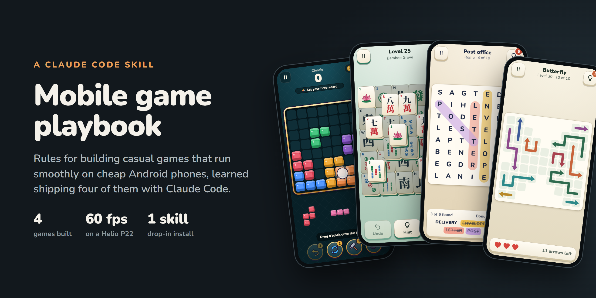

# Mobile Game Playbook for Claude Code

A Claude Code skill for building casual mobile games that run smoothly on cheap Android phones.

Every rule here comes from shipping real games with Claude Code: a block puzzle, a mahjong game, a word search, an arrow puzzle and a conveyor colour shooter. All five are HTML5 Canvas in a Capacitor WebView, all measured on a low-end phone (MediaTek Helio P22, 4 GB RAM, Android 10). Each rule exists because breaking it cost a rewrite, a bug or a lost day. The [case studies](case-studies/) have the measurements behind every one.

## Install

```bash
npx skills@latest add Ahmad1765/claude-mobile-game-playbook
```

Or copy it in by hand:

```bash
git clone https://github.com/Ahmad1765/claude-mobile-game-playbook
cp -r claude-mobile-game-playbook/skills/mobile-game-dev ~/.claude/skills/
```

Then just work as usual: "start a new puzzle game", "the game lags when lines clear", "prepare the Play release". Claude loads the skill whenever the task is about a mobile game.

## Why use it?

Agents write games that look fine on a desktop and stutter on the phones most players actually own.

Left alone, an agent will run a `requestAnimationFrame` loop that redraws a static board 60 times a second. It will read `getBoundingClientRect()` inside a pointer-move handler, use emoji as icons (they render differently on every Android maker), save to `localStorage` on the same frame the piece lands, and call the job done after testing in desktop Chrome. Each choice is small. Together they are the difference between 60 fps and a game that gets uninstalled.

This skill lists the mistakes we actually hit, what they cost, and the fix:

- **A confetti loop caused about 70 forced layouts per frame.** Fixed by caching geometry once per layout.
- **A board was squashed for three versions,** because the ad banner resized the page and desktop tests never had a banner.
- **Generating a puzzle took 210 ms at worst on desktop,** which is a visible freeze on the phone. One fix made it 8× faster.
- **A white flower on the app icon vanished at launcher size.**
- **The game name had already been taken four times over.** Found on day one, so nothing had to be redone.
- **Every level passed the solvability test, and a random player still won 99% of them.** The fix was in the content, not the difficulty knobs.

## Reference

- **[mobile-game-dev](./skills/mobile-game-dev/SKILL.md)** — The skill. Day-one decisions, reuse, design system, Canvas-in-WebView rendering rules, measuring on a real phone, architecture, on-device testing, scope, and working habits for Claude Code.
- **[device.mjs](./tools/device.mjs)** — Attach to your game's WebView on a USB phone: run JS, measure the frame rate during an action, list errors, take screenshots.
- **[Case studies](./case-studies/)** — The five development logs the rules come from, with the measurements and the bugs found, and how each was found.

### Measure on the phone, not the desktop

```bash
npm i -D playwright-core
APP_ID=com.example.game node tools/device.mjs fps "window.__dbg.confetti()" 3000
# {"syncMs":5.3,"fps":60,"late":"0%","worst":16.8,"frames":185}   (confetti, Helio P22)
```

You need adb, USB debugging on the phone, and a debug build (Capacitor debug builds allow WebView debugging).

## The games

| # | Game | Genre | What it taught |
|---|---|---|---|
| 1 | [Gemstack](case-studies/1-block-puzzle-gemstack.md) | Block puzzle | Four passes, all caused by decisions made too late: the device, the art direction, the rendering model |
| 2 | [Lotus Mahjong](case-studies/2-mahjong-lotus.md) | Mahjong pairs | Applying those lessons from day one; the edge-to-edge and storage quirks of Android 10 |
| 3 | [Word Passport](case-studies/3-word-search-word-passport.md) | Word search | Copying the last game instead of starting fresh; validating content automatically; large-text bugs |
| 4 | [Arrow Garden](case-studies/4-arrow-puzzle-arrow-garden.md) | Arrow tap-away | A level generator that is correct by construction; name collisions; confounded measurements |
| 5 | [Mosaic Parade](case-studies/5-color-shooter-mosaic-parade.md) | Conveyor colour shooter | One simulation shared by the game, solver and tests; measuring difficulty with a random player; continuous motion at 60 fps |

## The ten rules that mattered most

1. Check the game's name in the stores, and fix the package id and signing key, before writing code.
2. Copy your last project and trim it. Never start from scratch.
3. Build the on-phone measurement tools before the features, and set a frame-rate budget on your weakest phone.
4. Make a design system (tokens, SVG icons, components) before screens. No emoji in the UI.
5. Redraw only on change, move things with compositor transforms, and never read layout in a frame loop.
6. Test at 1.15× and 1.3× system text size, and with the real ad banner loaded.
7. Keep game rules pure and tested, and validate generated and written content automatically.
8. Run an on-device regression after every change, with real touch input, and fail on any page error.
9. Ship in small slices: game feel, then progression, then the daily puzzle, then the rest.
10. Keep a DEVLOG per game, and read the last one before starting the next.

## Contributing

Found a rule that saved you, or one that's wrong for your setup? Open an issue or a pull request with what happened, ideally with a measurement. Rules here come from something that actually went wrong or right, not from opinion.

## License

[MIT](LICENSE)
